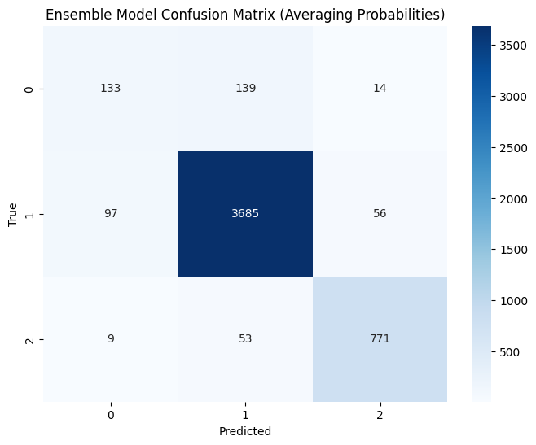
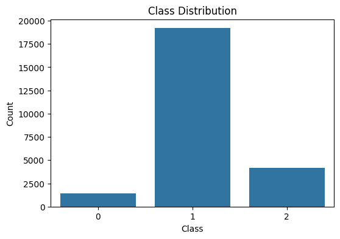

# Hate Speech Detection with Multi-Model Ensembles

Detecting hate speech in tweets by combining two fine-tuned transformers, **BERT** and **RoBERTa**, into an ensemble that is more accurate and better balanced across classes than either model alone.

Team project for **DS 340W** at Penn State, by Tisya Vaidya and [Sri Kunapuli](https://github.com/SriKunapuli).

## Problem

Hate speech datasets are heavily imbalanced: most offensive language is *not* hate speech, and the hateful class is small. Models trained on them tend to do well on overall accuracy while missing much of the hate speech itself. We built on the parent papers (Davidson et al., 2017, and the HateCheck functional tests) to see whether combining models could improve performance on that minority class.

## Data

- **Davidson et al. (2017):** about 25,000 tweets labelled *hate speech*, *offensive* or *neither*. It's highly imbalanced: about 6% of tweets are hate speech.
- **Founta et al. (2018):** a second, larger dataset used for comparison.
- **HateCheck:** functional test cases, used to probe specific behaviours such as negation, counter-speech and reclaimed slurs.

## Approach

1. **Preprocessing:** cleaned the tweets, with negation handling, lemmatisation and contextual normalisation.
2. **BERT:** fine-tuned for 3-class classification (reproducing the parent paper's model).
3. **RoBERTa:** a revised model fine-tuned on the same data.
4. **Ensemble:** combined both models' predictions in two ways, by **averaging their probabilities** and by **majority voting**.
5. **Evaluation:** per-class precision, recall and F1, plus macro F1 to weigh all classes equally.

## Results (Davidson 2017 test set)

| Model | Accuracy | Macro F1 | Hate speech F1 |
|---|---|---|---|
| BERT | 91% | 0.75 | 0.42 |
| RoBERTa | 91% | 0.76 | 0.44 |
| **Ensemble (averaging probabilities)** | **93%** | **0.79** | **0.51** |
| Ensemble (majority voting) | 92% | 0.80 | 0.55 |

- **The ensemble beat both individual models**, raising accuracy to 93% and macro F1 to 0.79–0.80.
- **Majority voting found more hate speech** (59% recall, against 47% for averaging), at the cost of a little precision. Which one is better depends on whether missing hate speech or flagging too much is the bigger cost.
- **Hate speech remains the hardest class.** Most errors are hateful tweets classified as merely offensive, as the confusion matrix shows.

## Repository

| File | What it does |
|---|---|
| `Copy_of_1_load_training_data.ipynb` | Loads and prepares the training data |
| `davidson_datacleaning.ipynb` | Cleaning and preprocessing |
| `2_train_BERT_multiclass.ipynb` | Fine-tunes BERT (3 classes) |
| `Revised_bert_model.ipynb` | Revised BERT training and evaluation |
| `roberta.ipynb` | Fine-tunes RoBERTa |
| `stacked_model.ipynb` | **The ensemble** (averaging and majority voting) |
| `3_apply_BERT_to_hatecheck.ipynb`, `4_eval_models_on_hatecheck.ipynb` | HateCheck functional tests |
| `davidson2017.csv`, `founta2018.csv` | Datasets |
| `*.pkl` | Saved training data and results |

[View the ensemble notebook with outputs on nbviewer](https://nbviewer.org/github/tisyavaidya/DS340W--Project/blob/main/stacked_model.ipynb)

## Tools

Python, PyTorch, Hugging Face Transformers, scikit-learn, pandas, Matplotlib, Seaborn

## References

- Davidson, T., Warmsley, D., Macy, M. and Weber, I. (2017). *Automated Hate Speech Detection and the Problem of Offensive Language.* ICWSM.
- Founta, A. M. et al. (2018). *Large Scale Crowdsourcing and Characterization of Twitter Abusive Behavior.* ICWSM.
- Röttger, P. et al. (2021). *HateCheck: Functional Tests for Hate Speech Detection Models.* ACL.

---

[Tisya Vaidya](https://tisyavaidya.com) · [LinkedIn](https://www.linkedin.com/in/tisya-vaidya/) · [GitHub](https://github.com/tisyavaidya)
